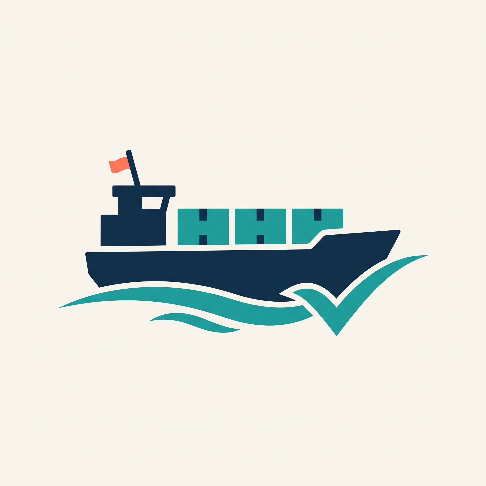

An opinionated framework for coding agents that earn the right to ship without routine human approval.

Managing a few agents can already consume your day. rapid-ship takes on task slicing, environment setup, work coordination, checks and review so you can focus on direction and difficult decisions. The work loop continues until the approved project is complete or a safety limit, missing resource or unresolved decision requires a pause.

**Scale your agents as trust grows.** Our ambition is 1,000 high-quality PRs a month without 1,000 approval requests—a target to validate, not an achieved benchmark.

## How it works

**Start with a design.** A short setup interview captures the project's stack, agents, environments, issue tracking and code hosting. rapid-ship splits the approved design into small tasks with clear ownership and dependencies. Each worker gets one task, including its tests; a stronger reviewer checks the result with project context.

**Give every project one CLI.** `./devctl` handles setup, task execution, checks, progress, stop/resume and quality metrics. People and agents use the same commands. The wrapper calls a pinned controller installed outside the code being changed.

**Keep work durable.** AstraBox is the selected runtime: its service coordinates coding sessions in isolated Docker sandboxes and stores their history outside worker processes. `devctl` keeps task state, checks and delivery decisions separately. Recovery inspects saved work and unfinished operations before continuing, avoiding blind retries. See the [architecture and runtime trial](docs/runtime-choice.md).

**Turn feedback into stronger defaults.** Review the first changes yourself. Track PR revisions, repeated corrections, defects, review effort, flaky tests, CI duration and mutation-test results. Fix recurring problems at the strongest practical rung:

| Rung | Put the fix here | Example |
| --- | --- | --- |
| **1. Make the mistake impossible** | Architecture, data structures and types | Keep merge credentials outside worker environments. |
| **2. Enforce it automatically** | Linters, compiler diagnostics and CI checks | Reject forbidden imports or a failing regression test. |
| **3. Guide agent judgment** | Skills, rules and automated PR review | Explain how to slice a task or assess an API change. |
| **4. Discover gaps through human review** | Human feedback and style guidance | Record a correction, then move repeatable fixes into rungs 1–2. |

Set quality thresholds before scaling. Increase concurrency and remove routine approval only after the evidence holds. Unknown metrics stay unknown. Individual workflows earn autonomy; a high PR count does not grant it.

**Improve through use.** Tell `rapid-ship-improve` what is missing or repeatedly going wrong. It separates project settings from framework gaps, checks existing work, and prepares a tested, reviewed PR. Upgrading a running controller is a separate step.

## Your stack. Your agents.

Projects can use any language. Choose the model, coding harness and execution environment separately. An environment adapter describes the isolation and resources a project needs: a worktree, a container, an OpenHands environment, dedicated AWS test resources, or a combination. Available adapters and their verification status are listed in [environment support](docs/environments.md).

| Component | Role |
| --- | --- |
| **rapid-ship / devctl** | Task planning, work coordination, checks, review and trust metrics |
| **AstraBox** | Managed coding sessions and Docker sandbox lifecycle |
| **Issue tracking — Linear initially** | Scope, dependencies, responsibility and progress |
| **Code hosting — GitHub initially** | Repositories, PRs, CI checks and merge history |
| **Your harnesses and models** | Workers and reviewers selected independently, including Codex, Claude Code and Antigravity CLI (`agy`) |

[Quota handling and handoffs](docs/session-handoffs.md) describe how approved model, harness or account alternatives should take over when a provider becomes unavailable.

## Try the preview

**Early preview:** the CLI, task execution, agent adapters, checks, review, recovery and metrics are available for supervised testing. AstraBox integration, automatic quota handoff, automated issue-tracker setup and unattended delivery are not enabled. See [current limits](docs/authority.md).

Requires Python 3.12+, Git and [uv](https://docs.astral.sh/uv/) on a POSIX host. Docker and model access are needed for live container runs.

```sh
git clone https://github.com/proxy-hatch/rapid-ship.git
cd rapid-ship
uv sync --locked
uv run devctl --help
```

Continue with [project setup](docs/usage.md) and the [preview test guide](docs/preview-testing.md).

[Task slicing](docs/task-slicing.md) · [Agent support](docs/agents.md) · [Quality metrics](docs/metrics.md) · [Improvement workflow](docs/improving-rapid-ship.md)

Try a small project, share where trust breaks down, or contribute a focused PR. Help make the next agent easier to trust than the last.

<p align="center"></p>
