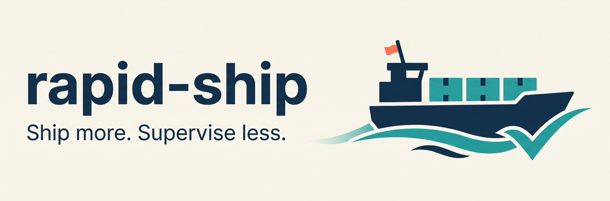

**Ship more software without becoming a full-time agent manager.**

rapid-ship takes an approved design through small tasks, implementation, checks and independent review. Each project gets a `devctl` CLI to coordinate work and record results. Choose your project language, models and supported coding tools.

Start supervised. Turn repeated corrections into enforced checks. Increase agent concurrency when measured quality holds. The goal: safe delivery with fewer approval requests.

## Ship your first PR

**[Build hello-rapid-ship →](https://proxy-hatch.github.io/rapid-ship/docs/getting-started/)**

Follow the commands from setup to a tested hello command, review, GitHub PR and quality metrics. Each step shows what to expect.

**Early preview:** supervised use is available. Automatic delivery remains gated. The badge reports repository checks. [See current limits](https://proxy-hatch.github.io/rapid-ship/architecture/#earn-autonomy).

## Explore

- [Use rapid-ship](https://proxy-hatch.github.io/rapid-ship/docs/usage/) — setup, start and improve from your coding agent.
- [How it works](https://proxy-hatch.github.io/rapid-ship/architecture/) — task coordination, environments and delivery rules.
- [Build trust](https://proxy-hatch.github.io/rapid-ship/docs/metrics/) — measure quality before adding agents.
- [Contribute an improvement](https://proxy-hatch.github.io/rapid-ship/docs/improving-rapid-ship/) — turn usage feedback into a reviewed change.

## Credits

Our engineering workflows adapt [Matt Pocock's skills](https://github.com/mattpocock/skills/), with [Ponytail](https://github.com/DietrichGebert/ponytail) by Dietrich Gebert. Thank you for sharing them. [Skill sources and credits](https://proxy-hatch.github.io/rapid-ship/docs/credits/).
