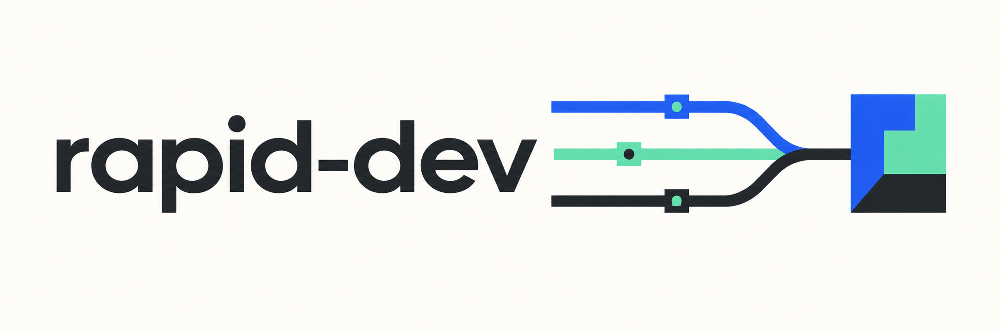

Build with coding agents, measure their work, and keep control of delivery.

Bring an approved design. **rapid-dev** helps you split it into small tasks, run agents in separate environments, check their work, and review changes through GitHub. Its `devctl` command works with projects in any programming language; Python is only required to run the tool itself.

## The workflow

1. **Set up:** answer a short interview about your repository, tools, agents, and checks.
2. **Slice:** turn the design into small tasks with clear ownership and dependencies.
3. **Trial:** review early changes yourself and establish a quality baseline.
4. **Harden:** turn repeated corrections into checks and approve only the automation you've tested.
5. **Run:** let independent tasks proceed in parallel while you track quality.

Start with one task at a time. Add agents only when the measurements support it.

## Try it

Requires Python 3.12+, Git, [uv](https://docs.astral.sh/uv/), and a POSIX host.

```sh
git clone --branch codex/bootstrap-framework https://github.com/proxy-hatch/rapid-dev.git
cd rapid-dev
uv sync --locked
uv run devctl --help
```

Next, [install a reviewed version and set up your project](docs/usage.md). The setup interview resumes where you left off and preserves existing project files.

Read how to [split work into agent tasks](docs/task-slicing.md) and [choose models, harnesses, and runtimes](docs/agents.md).

[Linear owns task management](docs/linear.md); GitHub owns code and PRs. Automatic Linear sync is planned.

## What works today

Task scheduling, Codex/Claude CLI adapters, an Antigravity (`agy`) adapter for Docker workers, independent checks and review, recovery after interruptions, and shared quality reports. Agent adapters still need live compatibility trials. Use `devctl metrics sync-github` to collect PR revisions, reviews, and basic CI results; [import other measurements](docs/metrics.md) from your tools.

**Early-stage software:** unattended delivery remains disabled pending live trials and a connected approval service. OpenHands and AWS provisioning need adapters. See [environment support](docs/environments.md) and [delivery permissions](docs/authority.md) before running agents.

Want to improve it? Start with a small change, run the [development checks](docs/usage.md#develop-devctl), and open a PR. Keep the code, docs, and conversations simple.

<p align="center"></p>
