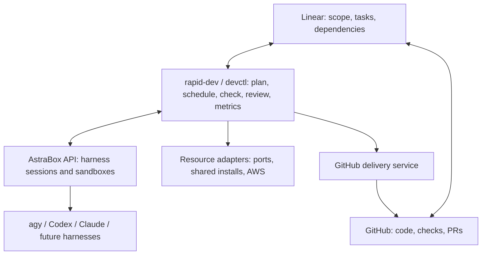

# Runtime choice: AstraBox, LightAgent or LangGraph

**Recommendation: use AstraBox as rapid-dev's coding runtime foundation, with a separate devctl service for SDLC policy.** Verify the integration in a short compatibility trial before replacing the prototype's direct runners. This compares the three candidates from requirements; existing prototype code is not a selection criterion.

## Comparison

| Requirement | AstraBox | LightAgent / LightDAG | LangGraph |
| --- | --- | --- | --- |
| Main abstraction | Managed coding harness sessions and sandboxes | Persistent dynamic task graph and verified artifacts | General stateful workflows |
| Local operation | Docker host; API/UI, PostgreSQL, LiteLLM, OpenSandbox | Python and SQLite; one scheduler per run | Embedded Python with local checkpoint storage; cloud service optional |
| BYO harness | Explicit engine adapter API and sandbox images | Callable worker wrapper; harness operations are ours | Python nodes can call any harness; harness operations are ours |
| BYO model | Routes must match the harness's protocol | Model APIs plus custom workers | Model libraries optional; custom nodes can use any compatible connection |
| Sandbox/session work reused | Substantial | No built-in coding sandbox | No built-in coding sandbox |
| Dynamic task planning | Rapid-dev supplies it | Decomposition proposals and verifier are built in | Dynamic fan-out and nodes; rapid-dev defines task rules |
| Recovery | Saved conversations; failed compute still needs task reconciliation | SQLite leases and verified artifacts; long-task renewal issue below | Checkpoint replay, interrupts and retries; external effects need reconciliation |
| Linear, GitHub delivery, trust metrics | Rapid-dev integration | Rapid-dev integration | Rapid-dev integration |
| License | Apache-2.0 | Apache-2.0 | MIT |

Sources: [AstraBox deployment](https://github.com/Colton-z/AstraBox/blob/main/docs/deploy.md), [engine adapters](https://github.com/Colton-z/AstraBox/blob/main/docs/writing-an-engine-adapter.md), [LightDAG](https://github.com/wanxingai/LightAgent/blob/v0.11.0/docs/lightdag.md), [LangGraph overview](https://docs.langchain.com/oss/python/langgraph/overview) and [persistence](https://docs.langchain.com/oss/python/langgraph/checkpointers).

AstraBox removes the most harness-hosting and sandbox work. Its extra services are a real operational cost, but Docker's adjustable memory is not a reason to reject it. Its reviewed version is beta; documented behavior still needs trials.

LangGraph is the stronger alternative when custom workflow orchestration is the main requirement. It can wrap existing CLIs without requiring LangChain agents. It leaves more runtime infrastructure to us, including process-tree cancellation and resource reservations. Do not introduce it alongside AstraBox until it removes a demonstrated workflow burden.

LightDAG is closer to our task graph than an ordinary model SDK. However, it is a new experimental runtime, and the local test below found a coding-task reliability problem. Reconsider it after that behavior is fixed and tested.

## Proposed architecture

Use AstraBox's [HTTP/SSE integration](https://github.com/Colton-z/AstraBox/blob/main/docs/embedding.md); add a plugin only where its public API cannot provide a needed capability. The `agy` engine adapter and compatible image are still required. OpenHands and AWS lifecycle support remain separate integrations.

Keep three distinct records: Linear's task plan, devctl's attempts/verification/operation log, and AstraBox's execution sessions. Checkpoint or session recovery does not prove an external operation completed.

The [default AstraBox Git setup](https://github.com/Colton-z/AstraBox/blob/main/docs/working-with-repos.md) places a deploy key in the sandbox. For rapid-dev, provide read-only source access or staged source and keep GitHub write/merge credentials in the delivery service. Model routing must also match the selected harness; an OpenAI-compatible URL alone is insufficient.

## LightDAG timing check

Tested unmodified DAG modules at `v0.11.0`, commit `8318a5d7cb7a573b6ee63ed5e10d0d23bf10466f`, with Python 3.13 and temporary SQLite/artifacts. No model calls were made. The probe bypassed top-level SDK imports; it tests the DAG modules, not the complete packaged application.

| Worker duration | Task/scheduler lease | Observed result |
| --- | --- | --- |
| 0.10 seconds | 0.04 seconds | Run blocked; task remained running; no artifact published |
| 0.10 seconds | 1 second | Run succeeded; task verified; one artifact published |

The [scheduler](https://github.com/wanxingai/LightAgent/blob/8318a5d7cb7a573b6ee63ed5e10d0d23bf10466f/LightAgent/dag/scheduler.py#L157-L193) renews between batches but not while awaiting the worker; [publication rejects expired leases](https://github.com/wanxingai/LightAgent/blob/8318a5d7cb7a573b6ee63ed5e10d0d23bf10466f/LightAgent/dag/store.py#L1095-L1107). Default leases are 60 seconds. Merely increasing them postpones the problem for longer coding/review work. This is a specific versioned finding, not a general performance ranking.

## Compatibility trial

Test two isolated sessions, actual `agy`/Gemini model authentication, a separately configured stronger reviewer, cancellation, service/container restart, preserved source changes, and one checked PR without worker GitHub write credentials. Measure resource use and recovery results. Do not add LightDAG and LangGraph in parallel or grant unattended delivery as part of this trial.
